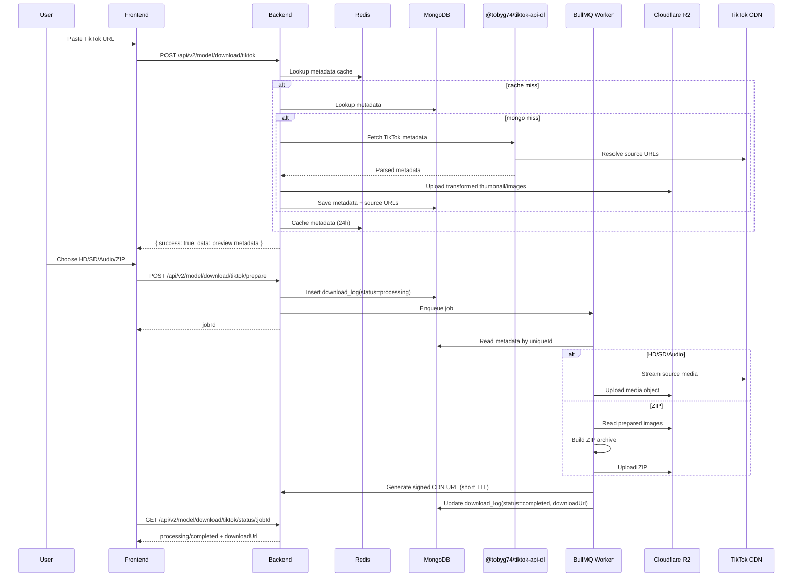

# eeetik backend

Secure and scalable NestJS backend for TikTok metadata + download workflows with:
- API app (`apps/eeetik_backend`)
- Worker app (`apps/worker`) using BullMQ
- Redis cache + queue
- MongoDB persistence
- Private Cloudflare R2 media storage with signed URLs
- Ad-gated download flow (Google AdSense + Google Tag Manager policy integration)

## Architecture

### Services
- **API service**: metadata fetch, prepare request, status polling, ad policy checks
- **Worker service**: background media transfer, ZIP generation, signed URL issuance
- **Redis**: metadata cache and BullMQ transport
- **MongoDB**: metadata + download logs
- **R2**: private media object storage
- **Cloudflare**: edge proxy, WAF, DDoS shielding, origin protection

### Sequence flow



## API endpoints

- `POST /api/v2/model/download/tiktok`
  - Body: `{ "url": "https://www.tiktok.com/..." }`
  - Returns `{ success: true, data }` where `data` includes `uniqueId`, `type`, `author`, `stats`, `hashtags`, `availableFormats`
  - `type: "video"` responses include `thumbnail` and `duration`
  - `type: "image"` responses include `images`
- `POST /api/v2/model/download/tiktok/prepare`
  - Body: `{ "uniqueId": "...", "requestType": "hd|sd|audio|zip", "adToken": "...", "adDurationSeconds": 30 }`
  - Returns `{ jobId, status }`
- `GET /api/v2/model/download/tiktok/status/:jobId`
  - Returns job status and signed URL when complete
- `GET /api/v2/health/live`
- `GET /api/v2/health/ready`
- `GET /api/v2/metrics` (Prometheus format)
- Preview response examples: `docs/preview-endpoint-output.md`

## Local development

1. Copy environment values:
   ```bash
   cp .env.example .env
   ```
2. Install dependencies:
   ```bash
   npm ci
   ```
3. Start infra:
   ```bash
   docker compose up -d mongodb redis
   docker compose ps
   ```
4. Wait until `mongodb` and `redis` are marked `healthy`, then run API and worker:
   ```bash
   npm run start:dev
   npm run start:worker:dev
   ```
5. (Optional) Run the full stack in Compose with dependency sequencing:
   ```bash
   docker compose up --build api worker
   ```

### Startup readiness diagnostics

- API and worker now perform startup dependency checks for MongoDB + Redis before NestJS initialization.
- Retries are concise (no repeated stack traces) and fail fast with actionable hints when the timeout is reached.
- Tuning knobs (see `.env.example`):
  - `STARTUP_DEPENDENCY_MAX_WAIT_MS` (default `60000`)
  - `STARTUP_DEPENDENCY_RETRY_INTERVAL_MS` (default `2500`)
  - `STARTUP_DEPENDENCY_PROBE_TIMEOUT_MS` (default `3000`)
- Metadata cache + single-flight tuning knobs:
  - `METADATA_CACHE_URL_TTL_SECONDS`, `METADATA_CACHE_UID_TTL_SECONDS`
  - `METADATA_SINGLEFLIGHT_LOCK_TTL_MS`
  - `METADATA_SINGLEFLIGHT_WAIT_RETRY_MS`, `METADATA_SINGLEFLIGHT_MAX_RETRIES`
- Troubleshooting commands:
  ```bash
  docker compose ps
  docker compose logs mongodb redis
  docker compose up -d mongodb redis
  ```

### Rate limiting

- API throttling uses Redis-backed distributed storage (shared across instances) with in-memory fallback if Redis rate-limit storage becomes unavailable.
- Global throttle env knobs:
  - `THROTTLE_TTL_MS` (default `60000`)
  - `THROTTLE_LIMIT` (default `120`)
  - `THROTTLE_BLOCK_DURATION_MS` (default: `THROTTLE_TTL_MS`)
- Expensive-route throttle knobs for:
  - `POST /api/v2/model/download/tiktok`
  - `POST /api/v2/model/download/tiktok/prepare`
  - Env: `THROTTLE_EXPENSIVE_TTL_MS`, `THROTTLE_EXPENSIVE_LIMIT`, `THROTTLE_EXPENSIVE_BLOCK_DURATION_MS`
- Redis throttle storage knobs:
  - `THROTTLE_REDIS_HOST` / `THROTTLE_REDIS_PORT` / `THROTTLE_REDIS_PASSWORD`
  - `THROTTLE_REDIS_KEY_PREFIX` (default `throttle`)
  - Unset knobs automatically fall back to `REDIS_HOST` / `REDIS_PORT` / `REDIS_PASSWORD`
- `GET /api/v2/health/live`, `GET /api/v2/health/ready`, and `GET /api/v2/metrics` are skipped from throttling.

## Operational logging

- Structured operational logs are emitted as JSON lines and appended to:
  - `${LOG_DIR}/operations.log` (default: `.local/logs/operations.log`)
- Default structured fields include `requestId`, `route`, `statusCode`, `durationMs`, and download-flow context (`cache`, `uniqueId`, `jobId`) where available.
- Environment settings:
  - `LOG_LEVEL=debug|info|warn|error` (default: `info`)
  - `LOG_DIR=<path>` (default: `.local/logs`)
- Existing files in the log directory are preserved; logs are append-only.
- Retention recommendation: rotate daily and keep 14–30 days (for local dev, 14 days is usually enough).

## Build, test, lint

```bash
npm run lint
npm run test -- --runInBand
npm run build
npm run loadtest:k6:seed
npm run loadtest:k6
```

## Load validation

Run e2e load validation against real TikTok + R2 + CDN setup:

```bash
LOADTEST_MODE=e2e BASE_URL=https://api.eeetik.app SAMPLE_TIKTOK_URL=https://www.tiktok.com/@.../video/... npm run loadtest:k6:e2e
```

Set `STORAGE_MAX_MONTHLY_BYTES` to your Cloudflare R2 free-tier or paid-tier policy before running production traffic. When current-month storage usage reaches this limit, new prepare requests are paused until the limit is increased.

## Container images

- API image: `Dockerfile.api`
- Worker image: `Dockerfile.worker`

```bash
docker build -f Dockerfile.api -t eeetik-api .
docker build -f Dockerfile.worker -t eeetik-worker .
```

## Heroku split deployment (API + worker)

This repo supports deploying two Heroku apps from the same codebase:
- API app domain: `https://api.eeetik.app`
- Worker app domain policy: `https://api1.eeetik.app`
- Signed media CDN domain: `https://cdn.eeetik.app`

1. Create two Heroku apps and switch both to container stack:
   ```bash
   heroku apps:create <api-app-name>
   heroku apps:create <worker-app-name>
   heroku stack:set container -a <api-app-name>
   heroku stack:set container -a <worker-app-name>
   ```
2. Prepare a private shared-services env file from template:
   ```bash
   cp infra/heroku/shared-services.env.example infra/heroku/shared-services.env
   ```
   Fill `infra/heroku/shared-services.env` with your external MongoDB URI and R2/CDN signing secrets.
   Use real values only (no angle-bracket placeholders like `<username>` or `<accountid>`).
3. Provision shared services and set shared secrets/env vars on both apps:
   ```bash
   infra/heroku/provision-shared-services.sh <api-app-name> <worker-app-name> infra/heroku/shared-services.env
   ```
   Add a 4th argument to override Redis plan (default: `heroku-redis:mini`).
    - Adds/reuses Heroku Redis on the API app and mirrors `REDIS_*` + `THROTTLE_REDIS_*` to both apps.
    - Applies fixed CDN/domain defaults (`SIGNED_URL_MODE=cdn`, `api.eeetik.app`, `api1.eeetik.app`, `cdn.eeetik.app`).
    - Applies shared runtime vars (`MONGO_URI`, `R2_*`, `CDN_SIGNING_SECRET`) to both apps.
    - Keeps media delivery CDN-only (signed `cdn.eeetik.app` URLs, never direct object-storage download hosts).
4. Deploy API and worker images:
   ```bash
   infra/heroku/deploy-api.sh <api-app-name>
   infra/heroku/deploy-worker.sh <worker-app-name>
   ```
   If Docker is installed and running, the scripts use container deployment.
   If Docker is unavailable, they automatically fall back to Heroku Git deployment.
5. Configure custom app domains:
   ```bash
   infra/heroku/configure-domains.sh <api-app-name> <worker-app-name>
   ```
6. Verify both apps are in sync:
   ```bash
   infra/heroku/check-shared-config.sh <api-app-name> <worker-app-name>
   ```
7. Configure `cdn.eeetik.app` in Cloudflare to your signed-media edge/origin path.
8. Run the production smoke check:
   ```bash
   infra/heroku/smoke-download-flow.sh
   ```
   Optional overrides:
   ```bash
   API_BASE_URL=https://api.eeetik.app ORIGIN_HEADER=https://eeetik.app SAMPLE_TIKTOK_URL=https://www.tiktok.com/@.../video/... infra/heroku/smoke-download-flow.sh
   ```

> Note: the worker app runs background jobs and typically does not serve public HTTP routes. Keep `api1.eeetik.app` as the worker app domain policy unless you intentionally add a web process.

### Heroku rollback runbook (split API + worker)

1. Check recent releases on each app:
   ```bash
   heroku releases -a <api-app-name>
   heroku releases -a <worker-app-name>
   ```
2. Roll back quickly to known-good release numbers if needed:
   ```bash
   heroku releases:rollback v<api-release> -a <api-app-name>
   heroku releases:rollback v<worker-release> -a <worker-app-name>
   ```
3. If you need to rebuild from a known-good commit, deploy each app with existing scripts:
   ```bash
   git checkout <known-good-commit>
   infra/heroku/deploy-api.sh <api-app-name>
   infra/heroku/deploy-worker.sh <worker-app-name>
   git checkout -
   ```
4. Re-validate after rollback:
   ```bash
   infra/heroku/check-shared-config.sh <api-app-name> <worker-app-name>
   infra/heroku/smoke-download-flow.sh
   ```

## Kubernetes deployment

Manifest templates are in `infra/k8s/`:
- `namespace.yaml`
- `configmap.yaml`
- `secret.template.yaml`
- `api-deployment.yaml`
- `api-service.yaml`
- `worker-deployment.yaml`
- `hpa.yaml`
- `ingress.yaml`

Apply in order after replacing placeholder values:

```bash
kubectl apply -f infra/k8s/namespace.yaml
kubectl apply -f infra/k8s/configmap.yaml
kubectl apply -f infra/k8s/secret.template.yaml
kubectl apply -f infra/k8s/api-deployment.yaml
kubectl apply -f infra/k8s/api-service.yaml
kubectl apply -f infra/k8s/worker-deployment.yaml
kubectl apply -f infra/k8s/hpa.yaml
kubectl apply -f infra/k8s/ingress.yaml
```

## Security notes

- Keep R2 bucket private; expose only signed URLs.
- Use `SIGNED_URL_MODE=cdn` and set `CDN_SIGNED_BASE_URL=https://cdn.eeetik.app`.
- Disable any R2 public development URL and anonymous object access.
- Route traffic through Cloudflare and restrict origin access to Cloudflare paths only.
- Use managed Redis/Mongo endpoints in deployed environments (no `127.0.0.1`/`localhost`).
- Do not expose direct object-storage download hosts (for example `*.r2.dev`, `*.cloudflarestorage.com`, `*.amazonaws.com`).
- Set strict `SITE_DOMAIN_ALLOWLIST` and `CORS_ORIGINS` for your frontend domain(s).
- Keep secrets in Kubernetes secrets or cloud secret manager, not in source code.
